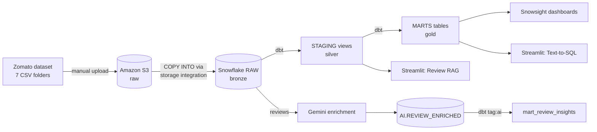

<div align="center">

# 🍽️ DineStream

**An end-to-end analytics pipeline for a food-delivery platform: Snowflake + dbt + Airflow, with LLM-powered review insights and natural-language querying.**

[](./LICENSE)
[](https://github.com/prashantrai-30/DineStream/commits/main)
[](https://github.com/prashantrai-30/DineStream/stargazers)


</div>

---

## 📖 Table of Contents

- [Overview](#-overview)
- [Features](#-features)
- [Tech Stack](#-tech-stack)
- [Architecture](#-architecture--how-it-works)
- [Data Model](#-data-model)
- [Getting Started](#-getting-started)
- [Usage](#-usage)
- [Roadmap](#-roadmap)
- [Contributing](#-contributing)
- [License](#-license)

---

## 🔎 Overview

**DineStream** models the data stack of a food-delivery business, built on the **Zomato dataset**. Raw CSVs (orders, order items, restaurants, menus, food, users, reviews) land in an **Amazon S3** data lake, are loaded into **Snowflake** through a storage integration, transformed into a tested star schema with **dbt** using a bronze → silver → gold layering, and orchestrated daily by **Airflow**.

On top of the warehouse sit two LLM-powered layers:

- **Review enrichment** — every new customer review is classified for sentiment, topic, and key issue, and the results flow back into dbt as an analytics mart.
- **Chat interfaces** — a **text-to-SQL** app for asking business questions in plain English, and a **RAG** app for asking questions about customer reviews.

### Why this project?

Business teams need trustworthy, up-to-date metrics (GMV, delivery SLAs, cancel rates) *and* a way to make sense of unstructured feedback at scale. DineStream shows how to serve both from one governed warehouse: a repeatable batch pipeline for the numbers, and LLMs for the free text.

---

## ✨ Features

- **Medallion architecture** — S3 lake → Snowflake `RAW` (bronze) → `STAGING` (silver) → `MARTS` (gold), with each layer cleanly separated.
- **Layered dbt project** — staging views and mart tables with a dimensional model (`fact_orders`, `fact_order_items`, `dim_*`) and business marts for revenue, delivery SLA, restaurant performance, and review insights.
- **Incremental loads** — `fact_orders` uses dbt's incremental `merge` strategy keyed on `order_id`, so daily runs only process new orders.
- **Data quality tests** — uniqueness and not-null checks on all primary keys, referential integrity between facts and dimensions, and accepted-value checks on order status.
- **Daily orchestration** — an Airflow 3 DAG runs load → dbt build → LLM enrichment → AI mart build, fully containerized with Docker Compose.
- **LLM review enrichment** — Gemini classifies each review (`sentiment_label`, `sentiment_score`, `topic`, `key_issue`) and writes to a dedicated `AI` schema.
- **Text-to-SQL chat** — ask questions in English; an LLM generates Snowflake SQL, guarded by a SELECT-only validator, and results are shown as a table and chart.
- **Review RAG chat** — semantic search over review embeddings, with answers grounded only in the retrieved reviews.
- **Serving layer** — Snowsight dashboards plus self-serve Streamlit apps on top of the marts.

---

## 🧰 Tech Stack

| Layer               | Technologies                                                   |
| ------------------- | -------------------------------------------------------------- |
| **Data lake**       | Amazon S3 (raw CSVs, one folder per table)                     |
| **Warehouse**       | Snowflake (`COPY INTO` via storage integration)                |
| **Transformation**  | dbt Core (`dbt-snowflake` 1.8)                                 |
| **Orchestration**   | Apache Airflow 3.0.3 (LocalExecutor), PostgreSQL 15 (metadata) |
| **LLMs**            | Google Gemini (review classification, embeddings), Groq-hosted `gpt-oss-20b` (chat & SQL generation) |
| **Serving / BI**    | Snowsight dashboards, Streamlit, pandas, NumPy                 |
| **Language**        | Python, SQL (Jinja-templated)                                  |
| **Infrastructure**  | Docker, Docker Compose                                         |

---

## 🏗️ Architecture / How It Works




| Layer      | Location            | What happens                                              |
| ---------- | ------------------- | --------------------------------------------------------- |
| **Source** | Zomato dataset      | 7 CSV folders: users, restaurants, food, menu, orders, order_items, reviews |
| **Lake**   | Amazon S3           | Raw CSVs, one folder per table (manual upload)            |
| **Bronze** | Snowflake `RAW`    | `COPY INTO` through a storage integration                 |
| **Silver** | Snowflake `STAGING` | dbt views: clean, type, and join                          |
| **Gold**   | Snowflake `MARTS`  | dbt dimensions, incremental facts, and marts              |
| **Serve**  | Snowsight, Streamlit | Dashboards and self-serve apps                          |

### Daily Airflow DAG: `dinestream_batch`

```
reload_raw  ──▶  dbt_build_core  ──▶  enrich_reviews  ──▶  dbt_build_ai
```

| Task             | What it does                                                                           |
| ---------------- | -------------------------------------------------------------------------------------- |
| `reload_raw`     | Runs `COPY INTO` for each raw table from the Snowflake stage                           |
| `dbt_build_core` | `dbt build --exclude tag:ai` — builds and tests staging and core marts                 |
| `enrich_reviews` | Classifies reviews not yet in `AI.REVIEW_ENRICHED` and appends the results             |
| `dbt_build_ai`   | `dbt build --select tag:ai` — builds marts that depend on the enrichment output        |

### Folder structure

```bash
DineStream/
├── ai/
│   ├── enrich_reviews.py        # LLM sentiment/topic classification → Snowflake
│   ├── rag_chat.py              # Streamlit RAG app over reviews
│   └── text_to_sql.py           # Streamlit natural-language → SQL app
├── airflow/
│   ├── dags/dinestream_batch.py # Daily batch DAG
│   ├── Dockerfile               # Airflow + Snowflake provider + dbt (isolated venv) + LLM SDKs
│   └── docker-compose.yaml      # Postgres, api-server, scheduler, dag-processor
├── dinestream/                  # dbt project
│   ├── models/
│   │   ├── staging/             # stg_* views over RAW sources
│   │   └── marts/               # dim_*, fact_*, mart_* tables
│   └── macros/generate_schema_name.sql
└── README.md
```

---

## 🗂️ Data Model

**Staging (views)** — `stg_orders`, `stg_order_items`, `stg_restaurants`, `stg_users`, `stg_food`, `stg_menu`, `stg_reviews`

**Marts (tables)**

| Model                         | Type          | Description                                                           |
| ----------------------------- | ------------- | --------------------------------------------------------------------- |
| `fact_orders`                 | Fact (incr.)  | One row per order: amounts, discount, fees, GST, rating, delivery time |
| `fact_order_items`            | Fact          | One row per order line item                                           |
| `dim_customer`                | Dimension     | Customer attributes and age segments                                  |
| `dim_restaurants`             | Dimension     | Restaurant, city, cuisine, rating, cost for two                       |
| `dim_food` / `dim_date`       | Dimension     | Food items and a date dimension                                       |
| `mart_daily_city_revenue`     | Mart          | Daily orders, cancel rate, GMV, and AOV by city                       |
| `mart_delivery_sla`           | Mart          | Median and p90 delivery time by city and hour                         |
| `mart_restaurant_performance` | Mart          | Orders, revenue, rating, and cancel rate per restaurant               |
| `mart_review_insights` 🤖     | Mart (`ai`)   | Sentiment, topics, and flagged issues per city from enriched reviews  |

---

## 🚀 Getting Started

### Prerequisites

- **Docker** and **Docker Compose** (for Airflow)
- **Python** 3.10+ (for the Streamlit apps)
- An **AWS account** with an S3 bucket, and a **Snowflake** account (a free trial works)
- A **Gemini API key** ([Google AI Studio](https://aistudio.google.com/)) and a **Groq API key** ([console.groq.com](https://console.groq.com/))
- The **Zomato dataset** as CSV files, not included in this repo (see `.gitignore`)

### 1. Clone the repository

```bash
git clone https://github.com/prashantrai-30/DineStream.git
cd DineStream
```

### 2. Set up Snowflake

Create the warehouse, database, schemas, role, and stage the pipeline expects:

```sql
CREATE WAREHOUSE IF NOT EXISTS DINESTREAM_WH WAREHOUSE_SIZE = 'XSMALL' AUTO_SUSPEND = 60;
CREATE DATABASE  IF NOT EXISTS DINESTREAM;
CREATE SCHEMA    IF NOT EXISTS DINESTREAM.RAW;
CREATE ROLE      IF NOT EXISTS DBT_ROLE;
-- Grant DBT_ROLE usage on the warehouse and create/write privileges on the database,
-- then grant the role to your user.

-- Storage integration so Snowflake can read your S3 bucket
CREATE STORAGE INTEGRATION IF NOT EXISTS DINESTREAM_S3_INT
  TYPE = EXTERNAL_STAGE
  STORAGE_PROVIDER = 'S3'
  ENABLED = TRUE
  STORAGE_AWS_ROLE_ARN = 'arn:aws:iam::<account-id>:role/<snowflake-access-role>'
  STORAGE_ALLOWED_LOCATIONS = ('s3://<your-bucket>/raw/');

-- External stage pointing at the bucket
CREATE STAGE IF NOT EXISTS DINESTREAM.RAW.DINESTREAM_RAW_STAGE
  URL = 's3://<your-bucket>/raw/'
  STORAGE_INTEGRATION = DINESTREAM_S3_INT
  FILE_FORMAT = (TYPE = CSV SKIP_HEADER = 1 FIELD_OPTIONALLY_ENCLOSED_BY = '"');
```

Upload the CSVs to S3 with one folder per table: `restaurants/`, `users/`, `food/`, `menu/`, `orders/`, `order_items/`, `reviews/`.

> [!NOTE]
> After creating the integration, run `DESC INTEGRATION DINESTREAM_S3_INT;` and use `STORAGE_AWS_IAM_USER_ARN` and `STORAGE_AWS_EXTERNAL_ID` in your IAM role's trust policy. See [Snowflake's S3 integration guide](https://docs.snowflake.com/en/user-guide/data-load-s3-config-storage-integration).

Then create the seven raw tables (`restaurants`, `users`, `food`, `menu`, `orders`, `order_items`, `reviews`) in `DINESTREAM.RAW`.

<!-- TODO: add snowflake/setup.sql with the full DDL and grants, and link it here -->

### 3. Configure environment variables

Create `airflow/.env`:

```env
# Snowflake
SNOWFLAKE_ACCOUNT=your_account_identifier
SNOWFLAKE_USER=your_user
SNOWFLAKE_PASSWORD=your_password
SNOWFLAKE_WAREHOUSE=DINESTREAM_WH
SNOWFLAKE_DATABASE=DINESTREAM
SNOWFLAKE_SCHEMA=RAW

# LLM providers
GEMINI_API_KEY=your_gemini_key
GROQ_API_KEY=your_groq_key

# Reviews to enrich per run
SAMPLE_N=5
```

> [!WARNING]
> `.env` and `profiles.yml` are git-ignored. Never commit credentials.

### 4. Configure dbt

Create `dinestream/profiles.yml` (the DAG reads it from the project directory):

```yaml
dinestream:
  target: dev
  outputs:
    dev:
      type: snowflake
      account: "{{ env_var('SNOWFLAKE_ACCOUNT') }}"
      user: "{{ env_var('SNOWFLAKE_USER') }}"
      password: "{{ env_var('SNOWFLAKE_PASSWORD') }}"
      role: DBT_ROLE
      database: DINESTREAM
      warehouse: DINESTREAM_WH
      schema: PUBLIC   # per-layer schemas (STAGING / MARTS) are set in dbt_project.yml
      threads: 4
```

### 5. Start Airflow

```bash
cd airflow
docker compose build
docker compose up -d
```

Open **http://localhost:8080** and sign in with `admin` / `admin`.

> [!CAUTION]
> The default credentials and JWT secret in `docker-compose.yaml` are for local development only. Change them before exposing this anywhere.

### 6. Run the Streamlit apps (optional)

```bash
# from the repo root
python -m venv .venv && source .venv/bin/activate     # Windows: .venv\Scripts\activate
pip install streamlit pandas numpy pyarrow python-dotenv \
            "snowflake-connector-python[pandas]" openai google-genai

streamlit run ai/text_to_sql.py
streamlit run ai/rag_chat.py
```

---

## 💡 Usage

### Run the pipeline

1. In the Airflow UI, enable the **`dinestream_batch`** DAG (scheduled `@daily`).
2. Trigger a run manually to load data right away.
3. Watch the four tasks run in order; task logs show dbt model and test results.

Run dbt on its own for development:

```bash
cd dinestream
dbt build --exclude tag:ai     # core models + tests
dbt build --select tag:ai      # AI-dependent models (after enrichment)
```

### Ask questions in plain English: `text_to_sql.py`

Example prompts:

- *Top 10 cities by GMV*
- *Average delivery time by city, worst first*
- *Cancel rate by payment method*

The app shows the generated SQL before running it. Only `SELECT`/`WITH` queries pass the safety check, and anything containing write or DDL keywords is rejected.

### Chat with your reviews: `rag_chat.py`

Embeds a sample of reviews, retrieves the top matches for your question by cosine similarity, and answers using only those reviews.

- *What are the most common complaints about delivery?*

### Enriched review output

`ai/enrich_reviews.py` writes one row per review to `DINESTREAM.AI.REVIEW_ENRICHED`:

| Column            | Example                         |
| ----------------- | ------------------------------- |
| `sentiment_label` | `negative`                      |
| `sentiment_score` | `-0.7`                          |
| `topic`           | `delivery`                      |
| `key_issue`       | `food arrived cold after delay` |

---

## 🗺️ Roadmap

- [ ] Add a `snowflake/setup.sql` script for one-command warehouse setup
- [ ] Add CI (GitHub Actions) running `dbt build` and linting on pull requests
- [ ] Expand dbt tests (freshness checks, custom data tests) and publish `dbt docs`
- [ ] Parallelize and batch review enrichment for larger volumes
- [ ] Persist review embeddings in Snowflake instead of a local Parquet cache
- [ ] Dashboard layer (BI tool or Streamlit) on top of the marts

See [open issues](https://github.com/prashantrai-30/DineStream/issues) for more.

---

## 🤝 Contributing

Contributions are welcome!

1. **Fork** the repository
2. **Create** a feature branch: `git checkout -b feature/your-feature`
3. **Commit** your changes: `git commit -m "feat: add your feature"`
4. **Push** the branch: `git push origin feature/your-feature`
5. **Open** a Pull Request

Please run `dbt build` and confirm all tests pass before submitting.

---

## 📄 License

Distributed under the **MIT License**. See [`LICENSE`](./LICENSE) for details.

<!-- TODO: add a LICENSE file to the repo root (GitHub: Add file → Create new file → LICENSE → choose MIT template) -->

---

## 📬 Contact

**Prashant Rai** · [GitHub](https://github.com/prashantrai-30) · [LinkedIn](https://www.linkedin.com/in/prashantkumarrai30)

<div align="center">

⭐ If you find this project useful, consider giving it a star!

</div>